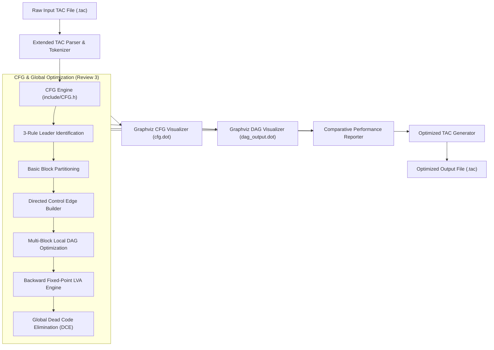

# DAG-Based Optimization for Basic Blocks & Control Flow Graphs (CFG)
> **Project Status:** Review 3 Milestone (100% Implementation Completed)

---

## 🎯 Review Milestones & Progress

| Milestone | Target | Status | Deliverables |
| :--- | :---: | :---: | :--- |
| **Review 1** | **25%** | ✅ Completed | Initial problem statement, basic `DAGNode` structure, hardcoded toy DAG construction. |
| **Review 2** | **75%** | ✅ **Completed** | Full TAC file parser, O(1) Value Numbering DAG engine, Commutative CSE, Variable reassignment & kill semantics, Constant Folding, Algebraic simplification, Optimized TAC Code Generator, Graphviz DOT visualizer, Empirical benchmarks. |
| **Review 3** | **100%** | ✅ **Completed** | TAC extension for control flow, standard 3-rule Leader Identification, Basic Block Partitioning, Control Flow Graph (CFG) with directed edges (fallthrough, branch True/False, loop-back), multi-block local DAG optimization coordinator, backward dataflow Global Live Variable Analysis (LVA: GEN, KILL, IN, OUT), and Global Dead Code Elimination (DCE). |

---

## 📖 Overview

Unoptimized Three-Address Code (TAC) generated by compiler frontends frequently contains redundant computations, dead temporaries, and inefficient control structures. This compiler optimization framework implements:

1. **Local Basic Block DAG Optimizer:** Employs an $O(1)$ Value Numbering search table, commutative canonicalization, constant folding, and strength reduction to eliminate local redundancies.
2. **Control Flow Graph (CFG) Engine:** Implements the Dragon Book 3-rule leader identification algorithm to partition TAC into basic blocks and connects them with directed control edges.
3. **Multi-Block Coordinator:** Optimizes every basic block locally while strictly preserving labels, jumps, and conditional branches.
4. **Global Live Variable Analysis (LVA):** Solves backward dataflow equations ($OUT[B] = \bigcup_{S} IN[S]$, $IN[B] = GEN[B] \cup (OUT[B] \setminus KILL[B])$) to fixed-point convergence.
5. **Global Dead Code Elimination (DCE):** Leverages $OUT[B]$ to purge dead temporary assignments across the entire CFG.

---

### ⚡ Example: Local & Global Optimizations Across Basic Blocks

| 🛑 Unoptimized Input (Before) | ⚡ Fully Optimized Output (After) | Optimization Applied |
| :--- | :--- | :--- |
| `t1 = a * b` | `t1 = a * b` | Initial computation |
| `t2 = a * b` | *(eliminated)* | **CSE + DCE:** Replaced by `t1`, never read, purged |
| `if x > 0 goto THEN_BLOCK` | `if x > 0 goto THEN_BLOCK` | **Control Flow:** Branch preserved |
| `t3 = c * d` | `t3 = c * d` | Computation |
| `t4 = c * d` | *(eliminated)* | **CSE + DCE:** Merged into `t3` and purged |
| `ans = t3 + t4` | `ans = t3 + t3` | **Copy Propagation:** Directly reuses `t3` |
| `goto MERGE` | `goto MERGE` | **Control Flow:** Unconditional jump preserved |

---

## ✨ Features Implemented (Review 3 - 100% Complete)

### 1. TAC Parser Extension for Control Flow
* **Labels:** Supports label definitions (`L1:`, `LOOP:`, `START:`).
* **Unconditional Jumps:** Recognizes `goto <label>` instructions.
* **Conditional Branches:** Parses unary and binary conditions (`if x < y goto L1`, `ifFalse a == b goto L2`, `if count goto LOOP`).
* **Comment Stripping:** Handles full-line and inline `#` and `//` comments.

### 2. Leader Identification & Basic Block Partitioning
* **Standard 3-Rule Leader Algorithm (Dragon Book Algorithm 8.4):**
  1. **Rule (a):** The first instruction in the TAC stream is a leader.
  2. **Rule (b):** Any instruction that is the target of a conditional or unconditional jump is a leader.
  3. **Rule (c):** Any instruction immediately following a conditional or unconditional jump is a leader.
* Partitions the instruction stream into distinct `BasicBlock` objects ($B_0, B_1, \dots, B_{k-1}$).

### 3. Control Flow Graph (CFG) Construction & Graphviz Visualization
* Builds directed control edges:
  * **Sequential Fallthrough Edges:** Connects sequential blocks.
  * **Conditional Branch Edges:** Distinguishes True and False target paths.
  * **Loop-Back Edges:** Detects and visualizes cycles returning to loop headers.
* **Graphviz DOT Exporter (`exportCFG`):** Emits rich `cfg.dot` diagrams displaying:
  * Block labels and instruction sequences.
  * Up-to-date $IN[B]$ and $OUT[B]$ live variable sets.
  * Color-coded edges: Green for True branch, Red for False branch, Blue dashed for Loop-back edges, Slate for fallthrough.

### 4. Multi-Block DAG Optimization Pass
* Applies the modular `DAGOptimizer` locally to every basic block in the CFG.
* Preserves entry labels and terminal jump/branch instructions while performing local Value Numbering, CSE, constant folding, and copy propagation.

### 5. Global Live Variable Analysis (LVA)
* Backward dataflow analysis computed to fixed-point convergence:
  $$\text{GEN}[B] = \text{Variables used in } B \text{ before being defined in } B$$
  $$\text{KILL}[B] = \text{Variables defined in } B$$
  $$\text{OUT}[B] = \bigcup_{S \in \text{succ}(B)} \text{IN}[S]$$
  $$\text{IN}[B] = \text{GEN}[B] \cup (\text{OUT}[B] \setminus \text{KILL}[B])$$
* Outputs detailed ASCII audit tables showing GEN, KILL, IN, and OUT per basic block.

### 6. Global Dead Code Elimination (DCE)
* Sweeps backwards through each block using $OUT[B]$.
* Eliminates dead compiler temporary assignments (`t2 = t1`, `tdead = ...`) where the assigned temporary is never read again downstream across the entire CFG.
* Re-runs LVA and DCE iteratively until fixed-point convergence.

---

## 🏗️ System Architecture



---

## 📁 Project Structure

```
DAG-Optimization/
├── include/                   # Modular C++ header declarations
│   ├── Instruction.h          # TAC instruction types, targetLabel, and inspection
│   ├── DAGNode.h              # DAG node structure and statistics
│   ├── Utils.h                # String trimming, number formatting, math helpers
│   ├── TACParser.h            # TAC line, string, and file parser
│   ├── DAGOptimizer.h         # Local basic-block DAG optimization engine
│   ├── CFG.h                  # Control Flow Graph, BasicBlock, and LVA/DCE declarations
│   ├── Visualizer.h           # Graphviz DOT exporters (DAG & CFG) and console formatters
│   └── BenchmarkRunner.h      # Automated benchmark test suite runner
├── src/                       # Modular C++ implementations
│   ├── Utils.cpp              # String and mathematical utility functions
│   ├── TACParser.cpp          # Robust TAC parsing (labels, gotos, branches, assignments)
│   ├── DAGOptimizer.cpp       # Value numbering, CSE, folding, code generation
│   ├── CFG.cpp                # Leader identification, partitioning, edges, LVA, DCE
│   ├── Visualizer.cpp         # ASCII tables and Graphviz export logic
│   ├── BenchmarkRunner.cpp    # Test case execution logic (Review 2 & Review 3)
│   └── main.cpp               # Interactive menu & CLI argument parsing
├── samples/                   # Curated benchmark test cases (.tac)
│   ├── sample1_readme.tac     # Standard CSE (Single-Block)
│   ├── sample2_commutative.tac# Commutative equivalence (Single-Block)
│   ├── sample3_reassignment.tac# Dragon book node kill semantics (Single-Block)
│   ├── sample4_constant_folding.tac # Constant folding & algebraic identities
│   ├── sample5_matrix_offset.tac    # Real-world array offset computation
│   ├── sample6_cfg_loop.tac   # CFG while-loop with conditional back-edge
│   ├── sample7_cfg_if_else.tac# CFG if-else diamond with merge block
│   └── sample8_cfg_lva_dce.tac# Multi-block loop with transitive DCE
├── Makefile                   # GNU Makefile for building and testing
├── dag_optimizer.cpp          # Single-translation-unit wrapper (legacy compatibility)
├── run_benchmarks.ps1         # Automated PowerShell test runner
├── run_tests.bat              # Automated Windows batch test runner
└── README.md                  # Project documentation
```

---

## 🚀 How to Build and Run

### 1. Compile

* **Using GNU Make / mingw32-make (Recommended):**
  ```bash
  mingw32-make
  ```
* **Using g++ (Modular):**
  ```bash
  g++ -std=c++17 -Wall -Wextra -Iinclude src/Utils.cpp src/TACParser.cpp src/DAGOptimizer.cpp src/CFG.cpp src/Visualizer.cpp src/BenchmarkRunner.cpp src/main.cpp -o dag_optimizer.exe
  ```
* **Using Single-File Wrapper:**
  ```bash
  g++ -std=c++17 dag_optimizer.cpp -o dag_optimizer.exe
  ```

### 2. Run Interactive Mode
```bash
./dag_optimizer.exe
```
Presents an interactive menu to run complete benchmark suites (Reviews 2 & 3), individual test cases, custom files, or interactive terminal input.

### 3. Run Command-Line Mode
```bash
./dag_optimizer.exe <input_file.tac> [output_file.tac]
```
Automatically detects whether the input is a single basic block or a multi-block CFG, runs the appropriate optimization pipeline, writes the optimized TAC, and exports `cfg.dot` / `dag_output.dot`.

### 4. Run Automated Benchmark Suite
* **Using Make:**
  ```bash
  mingw32-make test
  ```
* **PowerShell:**
  ```powershell
  .\run_benchmarks.ps1
  ```
* **Command Prompt:**
  ```cmd
  run_tests.bat
  ```

---

## 🧪 Benchmark Test Cases

| Benchmark | File | Focus Area |
| :--- | :--- | :--- |
| **Test Case 1** | `samples/sample1_readme.tac` | Standard CSE & Transitive Elimination |
| **Test Case 2** | `samples/sample2_commutative.tac` | Commutative Operator Equivalence (`+`, `*`) |
| **Test Case 3** | `samples/sample3_reassignment.tac` | Variable Reassignment & Dragon Book Kill Semantics |
| **Test Case 4** | `samples/sample4_constant_folding.tac` | Constant Folding & Algebraic Identities |
| **Test Case 5** | `samples/sample5_matrix_offset.tac` | Real-World Array Offset Calculation |
| **Test Case 6** | `samples/sample6_cfg_loop.tac` | CFG While Loop with Conditional Loop-Back Edge |
| **Test Case 7** | `samples/sample7_cfg_if_else.tac` | CFG If-Else Diamond with Merge Block & Convergence |
| **Test Case 8** | `samples/sample8_cfg_lva_dce.tac` | Multi-Block CFG with Fixed-Point LVA & Global DCE |

---

## 📊 Visual Graph Outputs (`.dot`)

Render generated `.dot` files using Graphviz:
```bash
# Render CFG topology with LVA dataflow annotations:
dot -Tpng cfg.dot -o cfg.png

# Render local DAG topology:
dot -Tpng dag_output.dot -o dag_output.png
```
Or paste `.dot` files into [Graphviz Online](https://dreampuf.github.io/GraphvizOnline/).
