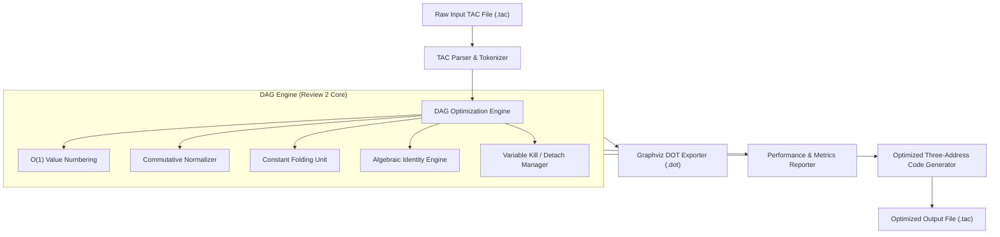

# DAG-Based Optimization for Basic Blocks
> **Project Status:** Review 2 Milestone (75% Implementation Completed)

---

## 🎯 Review Milestones & Progress

| Milestone | Target | Status | Deliverables |
| :--- | :---: | :---: | :--- |
| **Review 1** | **25%** | ✅ Completed | Initial problem statement, basic `DAGNode` structure, hardcoded toy DAG construction. |
| **Review 2** | **75%** | ✅ **Completed** | Full TAC file parser, O(1) Value Numbering DAG engine, Commutative CSE, Variable reassignment & kill semantics, Constant Folding, Algebraic simplification, Optimized TAC Code Generator, Graphviz DOT visualizer, Empirical benchmarks. |
| **Review 3** | **100%** | ⏳ Planned | Multi-block Control Flow Graph (CFG) analysis, live variable analysis, register allocation. |

---

## 📖 Overview

Unoptimized Three-Address Code (TAC) generated by compiler frontends frequently contains redundant computations that waste CPU cycles and memory bandwidth. This optimizer constructs a **Directed Acyclic Graph (DAG)** representation of basic blocks combined with an **$O(1)$ Value Numbering search algorithm** to eliminate duplicate computations, fold compile-time constants, simplify algebraic expressions, and emit mathematically sound, optimized Three-Address Code.

### ⚡ Example: Before vs After Optimization

| 🛑 Unoptimized Input (Before) | ⚡ Optimized Output (After) | Optimization Applied |
| :--- | :--- | :--- |
| `t1 = a * b` | `t1 = a * b` | Initial computation |
| `t2 = a * b` | `t2 = t1` | **CSE:** Reuses node `t1` |
| `t3 = c + d` | `t3 = c + d` | Initial computation |
| `t4 = t3 - t1` | `t4 = t3 - t1` | Computation |
| `t5 = c + d` | `t5 = t3` | **CSE:** Reuses node `t3` |
| `t6 = t5 - t2` | `t6 = t4` | **CSE:** Transitive redundancy eliminated |

---

## ✨ Features Implemented for Review 2 (75% Complete)

1. **Robust TAC File Parser & Tokenizer:**
   * Reads raw TAC from text files or terminal input.
   * Handles binary expressions (`res = a op b`), unary operations (`res = - a`), copy assignments (`res = a`), and numeric constants (`res = 10`).
   * Strips comments (`#` and `//`) and whitespace.

2. **Common Subexpression Elimination (CSE):**
   * Eliminates repeated evaluation of identical subexpressions across the basic block.
   * Employs an $O(1)$ Hash Map Signature Table (`op(leftNodeId, rightNodeId)`).

3. **Commutative Operator Recognition:**
   * Recognizes that operations like `a + b` and `b + a`, or `x * y` and `y * x` are functionally equivalent.
   * Canonicalizes operands using ordered IDs (`min(left, right), max(left, right)`).
   * Supports: `+`, `*`, `&`, `|`, `^`, `==`, `!=`.

4. **Variable Reassignment & Node Kill Semantics (Dragon Book Compliant):**
   * When a variable `a` is reassigned (`a = 10`), the variable label `a` is detached from its previous DAG node and attached to the new node.
   * Prevents erroneous aliasing when variables are reused inside a basic block.

5. **Constant Folding & Propagation:**
   * Statically evaluates compile-time constants (e.g. `12 + 8` $\to$ `20`, `20 * 2` $\to$ `40`).
   * Propagates folded constants through subsequent operations in the block.

6. **Algebraic Identity Reductions (Strength Reduction):**
   * $x + 0 \to x$, $0 + x \to x$
   * $x - 0 \to x$, $x - x \to 0$
   * $x \times 1 \to x$, $1 \times x \to x$
   * $x \times 0 \to 0$, $0 \times x \to 0$
   * $x / 1 \to x$, $x / x \to 1$

7. **Optimized TAC Code Generator:**
   * Replays DAG relationships to synthesize the finalized, minimal Three-Address Code.
   * Generates clean copy-assignments for shared subexpression results.

8. **Visual DAG Exporter (Graphviz DOT):**
   * Exports the entire graph topology to Graphviz `.dot` format.
   * Visualizes operators, leaf variables, constant nodes, and active labels.

9. **Empirical Performance Analyzer:**
   * Reports total instructions processed, redundant subexpressions eliminated, commutative matches, constant foldings, and algebraic identities reduced.
   * Outputs a formatted side-by-side comparison table.

---

## 🏗️ System Architecture



---

## 🚀 How to Build and Run

## 📁 Project Structure

```
DAG-Optimization/
├── include/                   # Header declarations
│   ├── Instruction.h          # TAC Instruction representation & types
│   ├── DAGNode.h              # DAG node structure & statistics
│   ├── Utils.h                # String trimming, number formatting, math helpers
│   ├── TACParser.h            # TAC file & string parser
│   ├── DAGOptimizer.h         # DAG optimization engine declaration
│   ├── Visualizer.h           # Graphviz DOT exporter & console formatters
│   └── BenchmarkRunner.h      # Benchmark test suite runner
├── src/                       # Component implementations
│   ├── Utils.cpp              # String and mathematical utility functions
│   ├── TACParser.cpp          # TAC line & file parsing implementation
│   ├── DAGOptimizer.cpp       # Value numbering, CSE, folding, code generation
│   ├── Visualizer.cpp         # ASCII tables and Graphviz export logic
│   ├── BenchmarkRunner.cpp    # Test case execution logic
│   └── main.cpp               # Interactive menu & CLI argument parsing
├── samples/                   # Curated benchmark test cases (.tac)
├── Makefile                   # GNU Makefile for building and testing
├── dag_optimizer.cpp          # Single-translation-unit wrapper (backward compatibility)
├── run_benchmarks.ps1         # Automated PowerShell test runner
├── run_tests.bat              # Automated Windows batch test runner
└── README.md                  # Project documentation
```

---

## 🚀 How to Build and Run

### 1. Compile

* **Using GNU Make / mingw32-make (Recommended):**
  ```bash
  mingw32-make
  ```
* **Using g++ (Modular):**
  ```bash
  g++ -std=c++17 -Wall -Wextra -Iinclude src/Utils.cpp src/TACParser.cpp src/DAGOptimizer.cpp src/Visualizer.cpp src/BenchmarkRunner.cpp src/main.cpp -o dag_optimizer.exe
  ```
* **Using VS Code:**
  Press `Ctrl + Shift + B` (configured in `.vscode/tasks.json`).
* **Using Single-File Wrapper:**
  ```bash
  g++ -std=c++17 dag_optimizer.cpp -o dag_optimizer.exe
  ```

### 2. Run Interactive Mode
```bash
./dag_optimizer.exe
```
This presents an interactive menu with options to run built-in test suites, custom files, or interactive terminal input.

### 3. Run Command-Line Mode
```bash
./dag_optimizer.exe <input_file.tac> [output_file.tac]
```
Example:
```bash
./dag_optimizer.exe samples/sample1_readme.tac optimized_sample1.tac
```

### 4. Run Automated Benchmark Suite
* **Using Make:**
  ```bash
  mingw32-make test
  ```
* **PowerShell:**
  ```powershell
  .\run_benchmarks.ps1
  ```
* **Command Prompt:**
  ```cmd
  run_tests.bat
  ```

---

## 🧪 Benchmark Test Cases

The project comes with 5 curated test cases in `samples/`:

| Benchmark | File | Focus Area |
| :--- | :--- | :--- |
| **Test Case 1** | `samples/sample1_readme.tac` | Standard CSE & Transitive Elimination |
| **Test Case 2** | `samples/sample2_commutative.tac` | Commutative Operator Equivalence (`+`, `*`) |
| **Test Case 3** | `samples/sample3_reassignment.tac` | Variable Reassignment & Dragon Book Kill Semantics |
| **Test Case 4** | `samples/sample4_constant_folding.tac` | Constant Folding & Algebraic Identities |
| **Test Case 5** | `samples/sample5_matrix_offset.tac` | Real-World Basic Block (Array Offset Calculation) |

---

## 📊 Sample Visual DAG Output (`.dot`)

Render generated `.dot` files using Graphviz:
```bash
dot -Tpng dag_output.dot -o dag_output.png
```
Or paste the `.dot` contents into [Graphviz Online](https://dreampuf.github.io/GraphvizOnline/).
