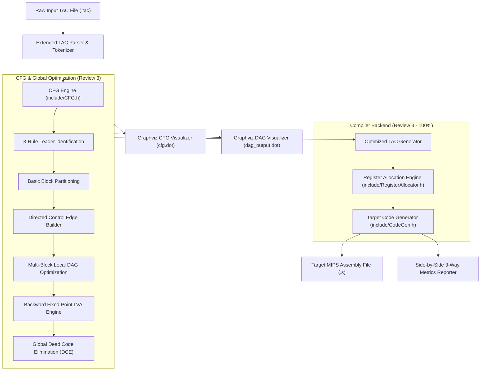

# DAG-Based Optimization for Basic Blocks, Control Flow Graphs (CFG) & Target Machine CodeGen
> **Project Status:** Review 3 Milestone (100% Implementation Completed)

---

## 🎯 Review Milestones & Progress

| Milestone | Target | Status | Deliverables |
| :--- | :---: | :---: | :--- |
| **Review 1** | **25%** | ✅ Completed | Initial problem statement, basic `DAGNode` structure, hardcoded toy DAG construction. |
| **Review 2** | **75%** | ✅ **Completed** | Full TAC file parser, O(1) Value Numbering DAG engine, Commutative CSE, Variable reassignment & kill semantics, Constant Folding, Algebraic simplification, Optimized TAC Code Generator, Graphviz DOT visualizer, Empirical benchmarks. |
| **Review 3** | **100%** | ✅ **Completed** | Extended TAC control flow parser, standard 3-rule Leader Identification, Basic Block Partitioning, Control Flow Graph (CFG) with directed edges (fallthrough, branch True/False, loop-back), multi-block local DAG coordinator, backward dataflow Global Live Variable Analysis (LVA), Global Dead Code Elimination (DCE), **Register Allocation Engine (with LRU Spilling)**, **Target Machine Assembly Code Generator (MIPS)**, and **Multi-Block Benchmark Suite**. |

---

## 📖 Overview

Unoptimized Three-Address Code (TAC) generated by compiler frontends frequently contains redundant computations, dead temporaries, and inefficient control structures. This compiler optimization framework implements:

1. **Local Basic Block DAG Optimizer:** Employs an $O(1)$ Value Numbering search table, commutative canonicalization, constant folding, and strength reduction to eliminate local redundancies.
2. **Control Flow Graph (CFG) Engine:** Implements the Dragon Book 3-rule leader identification algorithm to partition TAC into basic blocks and connects them with directed control edges.
3. **Multi-Block Coordinator:** Optimizes every basic block locally while strictly preserving labels, jumps, and conditional branches.
4. **Global Live Variable Analysis (LVA):** Solves backward dataflow equations ($OUT[B] = \bigcup_{S} IN[S]$, $IN[B] = GEN[B] \cup (OUT[B] \setminus KILL[B])$) to fixed-point convergence.
5. **Global Dead Code Elimination (DCE):** Leverages $OUT[B]$ to purge dead temporary assignments across the entire CFG.
6. **Register Allocation Engine:** Maps TAC variables and compiler temporaries to target machine registers (`$t0`–`$t9`, `$s0`–`$s7`) using a descriptor-based allocation strategy with Least-Recently-Used (LRU) spill handling to stack memory (`$sp`).
7. **Target Machine Code Generator:** Translates optimized TAC into valid, executable MIPS assembly with `.data` and `.text` segments, prologue/epilogue stack management, arithmetic/logic, loads/stores, and conditional/unconditional branch instructions.

---

### ⚡ Example: 3-Way Compiler Pipeline (Original TAC -> Optimized TAC -> Target Assembly)

```mips
# 1. Original TAC               # 2. Optimized TAC              # 3. Target MIPS Assembly
sum = 0                         sum = 0                         li $t0, 0
i = 1                           i = 1                           li $t1, 1
N = 100                         N = 100                         li $t2, 100
tdead0 = 50 * 2                 LOOP_HEADER:                    LOOP_HEADER:
LOOP_HEADER:                    if i > N goto LOOP_EXIT         lw $t0, 16($sp)
if i > N goto LOOP_EXIT         t1 = i * 4                      lw $t1, 20($sp)
t1 = i * 4                      t3 = sum + t1                   bgt $t0, $t1, LOOP_EXIT
t2 = i * 4                      sum = t3                        mul $t3, $t0, 4
t3 = sum + t1                   i = i + 1                       add $t5, $t4, $t3
t4 = sum + t2                   goto LOOP_HEADER                addi $t0, $t0, 1
sum = t4                        LOOP_EXIT:                      j LOOP_HEADER
i = i + 1                       result = sum                    LOOP_EXIT:
goto LOOP_HEADER                                                move $t1, $t0
LOOP_EXIT:                                                      li $v0, 10
result = sum                                                    syscall
```

---

## ✨ Features Implemented (Review 3 - 100% Complete)

### 1. TAC Parser Extension for Control Flow
* **Labels:** Supports label definitions (`L1:`, `LOOP:`, `START:`).
* **Unconditional Jumps:** Recognizes `goto <label>` instructions.
* **Conditional Branches:** Parses unary and binary conditions (`if x < y goto L1`, `ifFalse a == b goto L2`, `if count goto LOOP`).
* **Comment Stripping:** Handles full-line and inline `#` and `//` comments.

### 2. Leader Identification & Basic Block Partitioning
* **Standard 3-Rule Leader Algorithm (Dragon Book Algorithm 8.4):**
  1. **Rule (a):** The first instruction in the TAC stream is a leader.
  2. **Rule (b):** Any instruction that is the target of a conditional or unconditional jump is a leader.
  3. **Rule (c):** Any instruction immediately following a conditional or unconditional jump is a leader.
* Partitions the instruction stream into distinct `BasicBlock` objects ($B_0, B_1, \dots, B_{k-1}$).

### 3. Control Flow Graph (CFG) Construction & Graphviz Visualization
* Builds directed control edges:
  * **Sequential Fallthrough Edges:** Connects sequential blocks.
  * **Conditional Branch Edges:** Distinguishes True and False target paths.
  * **Loop-Back Edges:** Detects and visualizes cycles returning to loop headers.
* **Graphviz DOT Exporter (`exportCFG`):** Emits rich `cfg.dot` diagrams with block labels, instructions, live sets, and color-coded edges.

### 4. Multi-Block DAG Optimization Pass
* Applies the modular `DAGOptimizer` locally to every basic block in the CFG.
* Preserves entry labels and terminal jump/branch instructions while performing local Value Numbering, CSE, constant folding, and copy propagation.

### 5. Global Live Variable Analysis (LVA) & Dead Code Elimination (DCE)
* Backward dataflow analysis computed to fixed-point convergence:
  $$\text{GEN}[B] = \text{Variables used in } B \text{ before being defined in } B$$
  $$\text{KILL}[B] = \text{Variables defined in } B$$
  $$\text{OUT}[B] = \bigcup_{S \in \text{succ}(B)} \text{IN}[S]$$
  $$\text{IN}[B] = \text{GEN}[B] \cup (\text{OUT}[B] \setminus \text{KILL}[B])$$
* Sweeps backwards through each block using $OUT[B]$ to eliminate dead compiler temporary assignments (`t2 = t1`, `tdead = ...`).

### 6. Register Allocation Engine (with LRU Spilling)
* Maps temporary variables and program identifiers to target machine registers (MIPS `$t0`–`$t9`, `$s0`–`$s7`).
* Implements a register descriptor and address descriptor tracking system.
* Least-Recently-Used (LRU) spill policy: automatically evicts variables to stack slots (`offset($sp)`) when registers are exhausted.
* Flushes and synchronizes dirty registers across basic block and jump boundaries (`spillAll`).

### 7. Target Machine Code Generator (MIPS Architecture)
* Emits valid MIPS assembly targeting MARS / SPIM simulators or hardware.
* Instruction translation coverage:
  * **Arithmetic & Logic:** `add`, `sub`, `mul`, `div`, `rem`, `and`, `or`, `xor`, `neg`, `not`, `seq`, `sne`, `slt`, `sgt`, `sle`, `sge`.
  * **Immediate Loading & Copies:** `li`, `move`.
  * **Memory Operations:** `lw`, `sw` with 16-byte aligned stack frames.
  * **Branch & Jumps:** `beq`, `bne`, `blt`, `bgt`, `ble`, `bge`, `j`.
  * **Segments & Labels:** `.data` and `.text` segment generation, function prologue and epilogue, clean exit syscall (`li $v0, 10; syscall`).

---

## 🏗️ System Architecture



---

## 📁 Project Structure

```
DAG-Optimization/
├── include/                   # Modular C++ header declarations
│   ├── Instruction.h          # TAC instruction types, targetLabel, and inspection
│   ├── DAGNode.h              # DAG node structure and statistics
│   ├── Utils.h                # String trimming, number formatting, math helpers
│   ├── TACParser.h            # TAC line, string, and file parser
│   ├── DAGOptimizer.h         # Local basic-block DAG optimization engine
│   ├── CFG.h                  # Control Flow Graph, BasicBlock, and LVA/DCE declarations
│   ├── Visualizer.h           # Graphviz DOT exporters and 3-way side-by-side comparison
│   ├── BenchmarkRunner.h      # Automated benchmark test suite runner
│   ├── RegisterAllocator.h    # Register allocation with LRU spilling & descriptors
│   └── CodeGen.h              # Target MIPS machine assembly emitter & metrics
├── src/                       # Modular C++ implementations
│   ├── Utils.cpp              # String and mathematical utility functions
│   ├── TACParser.cpp          # Robust TAC parsing (labels, gotos, branches, assignments)
│   ├── DAGOptimizer.cpp       # Value numbering, CSE, folding, code generation
│   ├── CFG.cpp                # Leader identification, partitioning, edges, LVA, DCE
│   ├── Visualizer.cpp         # ASCII tables, Graphviz export & 3-way alignment logic
│   ├── BenchmarkRunner.cpp    # Test case execution logic (Reviews 1, 2 & 3)
│   ├── RegisterAllocator.cpp  # Register and address descriptors with stack spills
│   ├── CodeGen.cpp            # MIPS instruction emitter, prologue/epilogue
│   └── main.cpp               # Interactive menu & CLI argument parsing
├── samples/                   # Curated benchmark test cases (.tac)
│   ├── sample1_readme.tac     # Standard CSE (Single-Block)
│   ├── sample2_commutative.tac# Commutative equivalence (Single-Block)
│   ├── sample3_reassignment.tac# Dragon book node kill semantics (Single-Block)
│   ├── sample4_constant_folding.tac # Constant folding & algebraic identities
│   ├── sample5_matrix_offset.tac    # Real-world array offset computation
│   ├── sample6_cfg_loop.tac   # CFG while-loop with conditional back-edge
│   ├── sample7_cfg_if_else.tac# CFG if-else diamond with merge block
│   ├── sample8_cfg_lva_dce.tac# Multi-block loop with transitive DCE
│   ├── sample6_loop_sum.tac   # Multi-block loop sum accumulation with redundancies
│   ├── sample7_factorial.tac  # Loop-based iterative factorial computation
│   └── sample8_if_else_branches.tac # Nested if-else branches & dead code
├── Makefile                   # GNU Makefile for building and testing
├── dag_optimizer.cpp          # Single-translation-unit wrapper (legacy compatibility)
├── run_benchmarks.ps1         # Automated PowerShell test runner
├── run_tests.bat              # Automated Windows batch test runner
└── README.md                  # Project documentation
```

---

## 🚀 How to Build and Run

### 1. Compile

* **Using GNU Make / mingw32-make:**
  ```bash
  mingw32-make
  ```
* **Using g++ (Modular):**
  ```bash
  g++ -std=c++17 -Wall -Wextra -Iinclude src/Utils.cpp src/TACParser.cpp src/DAGOptimizer.cpp src/CFG.cpp src/Visualizer.cpp src/BenchmarkRunner.cpp src/RegisterAllocator.cpp src/CodeGen.cpp src/main.cpp -o dag_optimizer.exe
  ```
* **Using Single-File Wrapper:**
  ```bash
  g++ -std=c++17 dag_optimizer.cpp -o dag_optimizer.exe
  ```

### 2. Run Interactive Mode
```bash
./dag_optimizer.exe
```
Presents an interactive menu to run complete benchmark suites (Reviews 1, 2 & 3), individual test cases, custom files, or interactive terminal input with target assembly generation.

### 3. Run Command-Line Mode
* **Generate Optimized TAC and Assembly:**
  ```bash
  ./dag_optimizer.exe <input_file.tac> [output_file.tac] [output_assembly.s]
  ```
* **Assembly Emitter Flag (`-S` / `--asm`):**
  ```bash
  ./dag_optimizer.exe -S <input_file.tac> [output_assembly.s]
  ```

### 4. Run Automated Benchmark Suite
* **Using Make:**
  ```bash
  mingw32-make test
  ```
* **PowerShell:**
  ```powershell
  .\run_benchmarks.ps1
  ```
* **Command Prompt:**
  ```cmd
  run_tests.bat
  ```

---

## 🧪 Benchmark Test Suite

| Benchmark | File | Focus Area |
| :--- | :--- | :--- |
| **Test Case 1** | `samples/sample1_readme.tac` | Standard CSE & Transitive Elimination |
| **Test Case 2** | `samples/sample2_commutative.tac` | Commutative Operator Equivalence (`+`, `*`) |
| **Test Case 3** | `samples/sample3_reassignment.tac` | Variable Reassignment & Dragon Book Kill Semantics |
| **Test Case 4** | `samples/sample4_constant_folding.tac` | Constant Folding & Algebraic Identities |
| **Test Case 5** | `samples/sample5_matrix_offset.tac` | Real-World Array Offset Calculation |
| **Test Case 6** | `samples/sample6_cfg_loop.tac` | CFG While Loop with Conditional Loop-Back Edge |
| **Test Case 7** | `samples/sample7_cfg_if_else.tac` | CFG If-Else Diamond with Merge Block & Convergence |
| **Test Case 8** | `samples/sample8_cfg_lva_dce.tac` | Multi-Block CFG with Fixed-Point LVA & Global DCE |
| **Benchmark 6** | `samples/sample6_loop_sum.tac` | While Loop Sum Accumulation with Redundant Calculations |
| **Benchmark 7** | `samples/sample7_factorial.tac` | Loop-Based Factorial Computation with Conditional Branching |
| **Benchmark 8** | `samples/sample8_if_else_branches.tac` | Nested If-Else Branches & Path-Based Dead Code Elimination |

---

## 📊 Visual Graph & Assembly Outputs

Render generated `.dot` files using Graphviz:
```bash
# Render CFG topology with LVA dataflow annotations:
dot -Tpng cfg.dot -o cfg.png

# Render local DAG topology:
dot -Tpng dag_output.dot -o dag_output.png
```
Generated `.s` files can be directly loaded and executed in MIPS simulators such as **MARS** (MIPS Assembler and Runtime Simulator) or **SPIM**.
